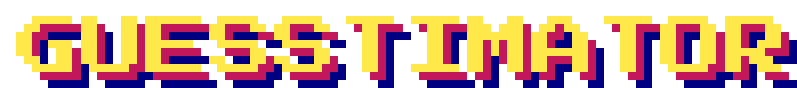

<h1 align="center"></h1>

An 8-ball that tells you how long your project will take. One time in six it gives a classic 8-ball non-answer; otherwise an LLM gives a realistic estimate in a mystical tone.

Built by directing an AI coding assistant (Claude). I owned requirements, review, security decisions and deployment.

**Try it: https://guesstimator.kateolenya.workers.dev**

<p align="center"></p>

## Stack

- **Cloudflare Workers** with static assets: one Worker serves the page and `POST /api/estimate`.
- **Workers AI**: `@cf/google/gemma-4-26b-a4b-it` writes the answers and `@cf/meta/llama-3.1-8b-instruct-fp8-fast` checks them, both through a binding (no API key).
- **TypeScript** backend, plain HTML/CSS/JS frontend, **Vitest** tests.
- Runs entirely on Cloudflare's free tier.

```
public/          static page (index.html, style.css, app.js, fonts, images, _headers)
src/index.ts     Worker: routing, rate limit, request checks, AI call
src/oracle.ts    pure logic: validation, joke roll, prompt, output cleaning
test/            unit tests
wrangler.jsonc   Worker config and bindings
```

## Security and cost controls

- Input capped at 1,000 characters; request body at 4 KB, refused before reading when `Content-Length` declares more.
- Per-IP rate limit, 5 requests/minute (Cloudflare rate-limiting binding; approximate by design). Accepted risk: one script at that rate can still use up the free daily AI quota (about 850 answers) in about 3 hours. The ball then says the spirits are tired until the quota resets at midnight UTC. On the free plan this costs nothing.
- Rejects cross-site browser requests (Origin check, strict `application/json` media type). Requests without an Origin header, like curl, are allowed: this is CSRF protection, not access control.
- User text wrapped in `<project>` tags with every `<` neutralised, so it can't close the tag; system prompt says to treat it as data, worked examples show how to answer takeover attempts, and the rules are repeated after the user's text.
- Answers are checked before they're shown: the model's non-answer becomes a random hazy line; an answer with no digit or time word, or one a second model call (the judge, which sees only the answer, never the user's text) flags as insulting, about the site or its maker, giving unrelated instructions or otherwise harmful, becomes a canned joke. Judge errors fail closed.
- Output capped at 150 tokens; control, zero-width and bidi-override characters stripped; rendered with `textContent` only.
- Strict CSP: scripts, styles and fonts from this origin only (fonts are self-hosted).
- Internal errors, including unexpected ones, are logged and never returned. When the free daily AI quota runs out, the ball says so in character.

## Run tests

```bash
npm install
npm test
npm run typecheck
```

## Deploy

1. Create a free Cloudflare account and verify your email.
2. Install Node.js 22.12 or later.
3. In this folder:
   ```bash
   npm install
   npx wrangler login    # opens the browser to link your account
   npm run deploy
   ```
4. Wrangler prints your URL: `https://guesstimator.<your-subdomain>.workers.dev`.

To try it against the real model before deploying: `npm run dev` (uses Workers AI remotely, counts toward the free quota).

Logs: Cloudflare dashboard → Workers & Pages → guesstimator → Logs.

## Credits

Fonts: Press Start 2P by CodeMan38 and VT323 by Peter Hull, both under the SIL Open Font License 1.1 (license texts in `public/fonts/`).

Answers: Gemma 4 by Google (Apache 2.0). Answer checker: Built with Llama (Meta Llama 3.1 8B). Both via Cloudflare Workers AI.

Background and 8-ball: my own pixel art.

## Privacy

- What you type is sent to Cloudflare Workers AI to get an answer. Don't enter anything confidential.
- Your IP address is used for the rate limit.
- No cookies, no analytics, no tracking.
- The site logs errors and answers the checker blocks, for debugging. Cloudflare, which hosts the site, also keeps short-lived request logs under its own privacy policy.

## License

Code: MIT, see [LICENSE](LICENSE).

My artwork is not covered by the MIT License: © 2026 Kateryna Kaidenko, all rights reserved. That is `public/images/starfield.png` (background), `public/images/ball.png` (8-ball) and `docs/8-ball.png` (8-ball, enlarged).

Fonts: SIL Open Font License 1.1, license texts in `public/fonts/`.
